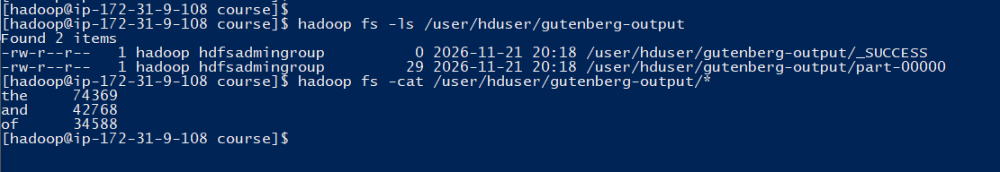

# Hadoop Training Questions

## Exercise 1

| Metric | Run 1 (Default) | Run 2 (`-numReduceTasks 6`) |
| :--- | :---: | :---: |
| Launched map tasks | 9 | 9 |
| Launched reduce tasks | 3 | 6 |
| Merged Map outputs | 27 | 54 |
| Output partition files (`part-*`) | 3 | 6 |

**Q1. How many files are there?**  
There are 6 output partition files (`part-00000` to `part-00005`), plus 1 `_SUCCESS` file (7 items in total). In the default run, there were 3 partition files (4 items in total).

**Q2. Did the number of mappers change?**  
No. It stayed 9 (`Launched map tasks=9`) because `-numReduceTasks` only changes the number of reducers, not the input splits.

**Q3. Did the number of reducers change?**  
Yes. It changed from 3 (default) to 6 (`Launched reduce tasks=6`) because we passed `-numReduceTasks 6`.

**Q4. Did the number of output files change? Why?**  
Yes, from 3 to 6. Each reducer writes its own output file (`part-0000X`), so the number of output files always equals the number of reducers.

**Q5. What does the value of 'Merged Map outputs' represent, and how is it calculated?**  
It is the total number of map output partitions sent to and merged by all reducers during the shuffle phase.  
Formula: `Mappers × Reducers`  
- Run 1: `9 × 3 = 27`  
- Run 2: `9 × 6 = 54`

---

## Exercise 2

**Q1. Is your change in the mapper or in the reducer?**  
In the **mapper** (`mapper_ex2.py`). Words must be lowercased and stripped of trailing commas and dots before MapReduce groups and sorts them by key.

**Q2. Please provide your code on GitHub**  
Code file: [`mapper_ex2.py`](./mapper_ex2.py)

---

## Exercise 3

**Q1. Is your change in the mapper or in the reducer?**  
In the **reducer** (`reducer_ex3.py`). Sorting by total word count and keeping only the top 3 words can only happen after all counts are summed in the reducer (run with `-numReduceTasks 1` for a single global top 3).

**Q2. Please provide your code on GitHub**  
Code file: [`reducer_ex3.py`](./reducer_ex3.py)

**Q3. Print the output of the MapReduce and put in your GitHub as an image**  
Top 3 words:
- `the` — 74369
- `and` — 42768
- `of` — 34588

